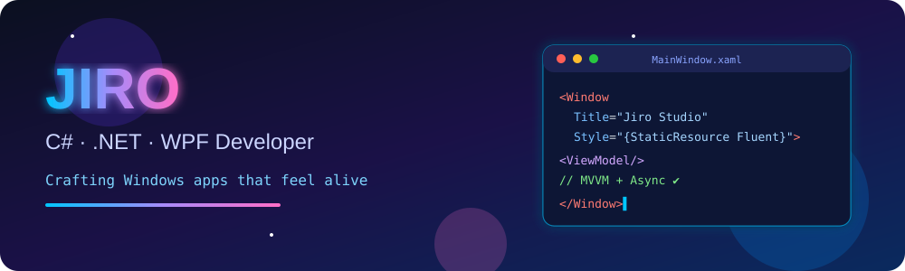

      

 

<h2 align="center"> About Me</h2>

<b>I turn "boring" Windows desktops into fluid, modern experiences.</b>

<table align="center">
<tr><td> <b>Focus</b></td><td>C# desktop apps &amp; custom XAML controls</td></tr>
<tr><td> <b>UI</b></td><td>Modern WPF &middot; Fluent design &middot; smooth animations</td></tr>
<tr><td> <b>Architecture</b></td><td>MVVM &middot; Clean Code &middot; Async programming</td></tr>
<tr><td> <b>Learning</b></td><td>Performance tuning, WinUI 3, advanced composition</td></tr>
<tr><td> <b>Reach me</b></td><td><a href="https://github.com/Project-Tons">GitHub</a></td></tr>
</table>

<h2 align="center"> Featured Project</h2>

<b>WallpaperTONS</b> is a lightweight open-source utility for Windows 10/11: live wallpapers and taskbar transparency with high performance.

 Live wallpapers &nbsp;&nbsp;  Taskbar transparency &nbsp;&nbsp;  Lightweight &amp; fast

<h2 align="center"> Tech Stack</h2>

  

<h2 align="center"> GitHub Stats</h2>

<h2 align="center"> Contribution Snake</h2>

<picture>
  <source media="(prefers-color-scheme: dark)" srcset="https://raw.githubusercontent.com/Project-Tons/Project-Tons/output/snake-dark.svg">
  
</picture>

 

 <i>Make it work, make it right, make it beautiful.</i> 

