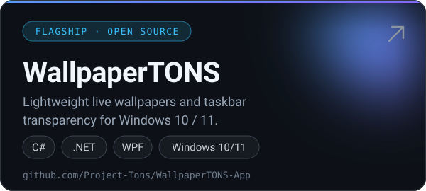
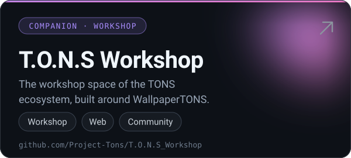
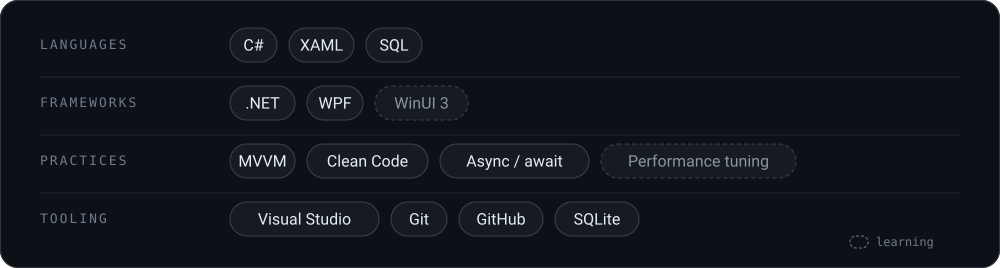

<div align="center">



<br>

<a href="https://github.com/Project-Tons/WallpaperTONS-App"></a>
<a href="https://project-tons.free.nf/"></a>
<a href="https://github.com/Project-Tons/T.O.N.S_Workshop"></a>
<a href="https://walltons.free.nf/"></a>

</div>

<br>

## About

I build Windows desktop software with **C#, .NET and WPF** — with a focus on custom XAML controls, smooth animations and clean MVVM architecture. I care about apps that feel native, fast and polished.

## Projects

<p align="center">
  <a href="https://github.com/Project-Tons/WallpaperTONS-App"></a>
  <a href="https://github.com/Project-Tons/T.O.N.S_Workshop"></a>
</p>

## Stack

<p align="center">
  
</p>

## How I structure code

```csharp
public sealed partial class WallpaperViewModel : ObservableObject
{
    [ObservableProperty] private bool isTaskbarTransparent;
    [ObservableProperty] private string status = "Ready";

    [RelayCommand]
    private async Task ApplyAsync(WallpaperItem item)
    {
        await _engine.SetLiveWallpaperAsync(item);
        Status = "Applied";
    }
}
```

## Currently

- Building and polishing **WallpaperTONS** and the **T.O.N.S Workshop**
- Exploring **WinUI 3** and advanced composition
- Performance tuning for WPF rendering

<br>

<p align="center"><sub>Make it work, make it right, make it beautiful.</sub></p>
